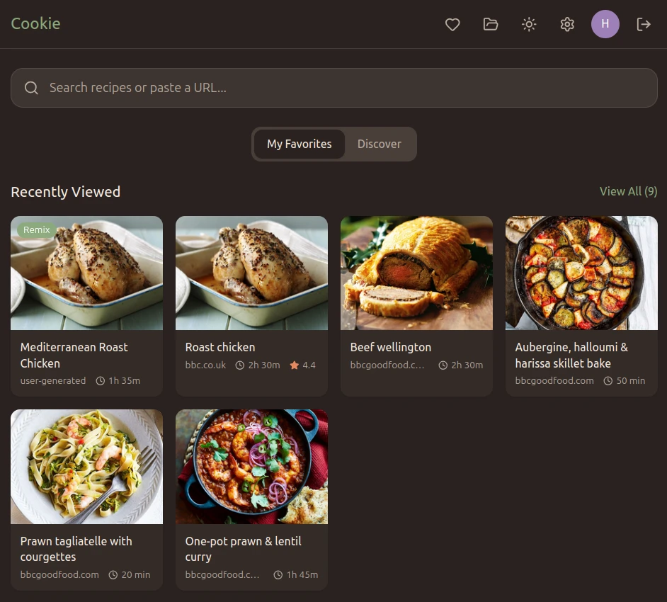
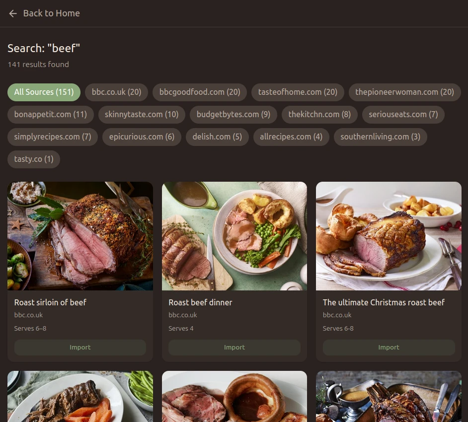
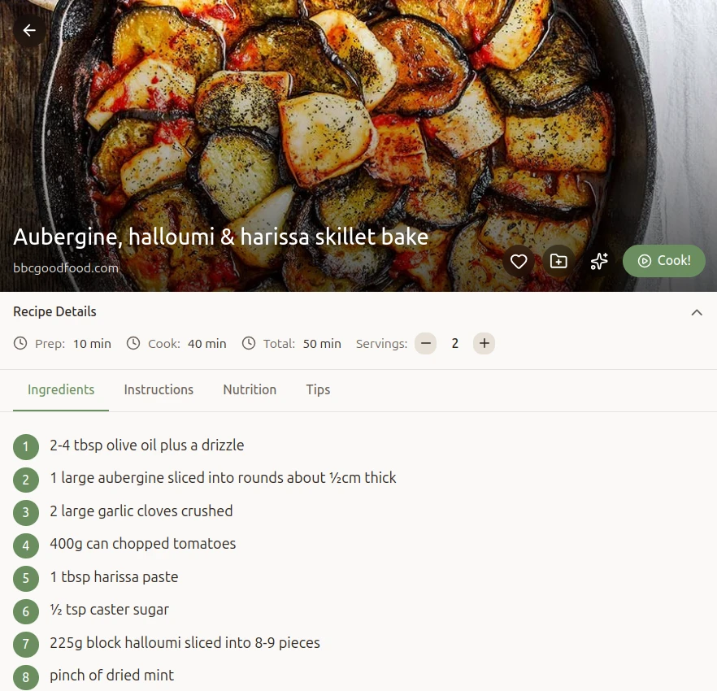
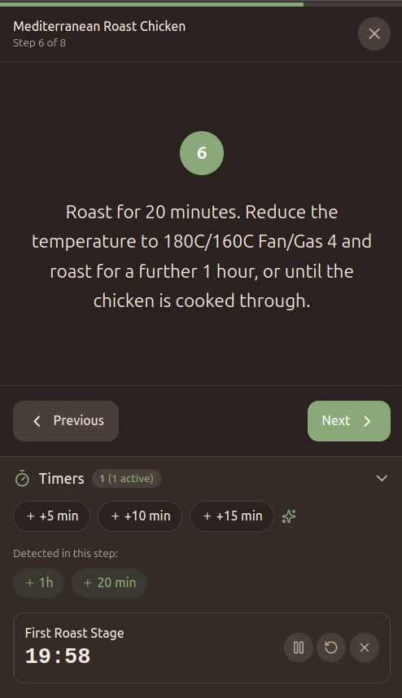
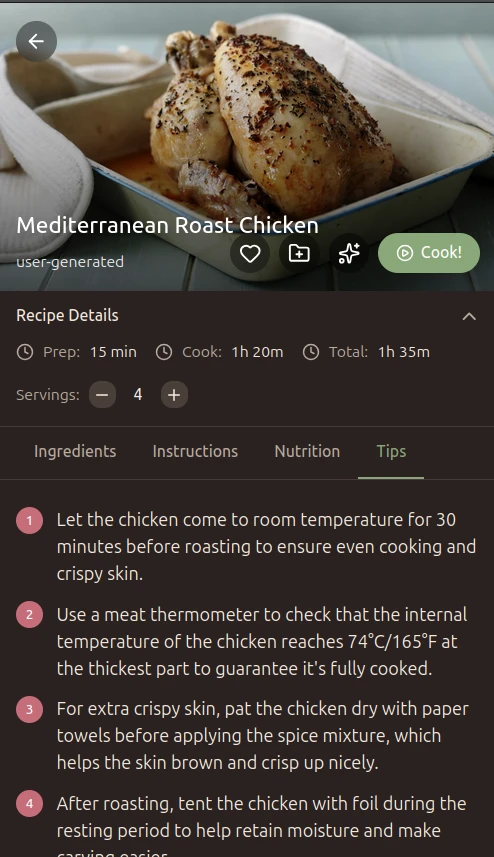
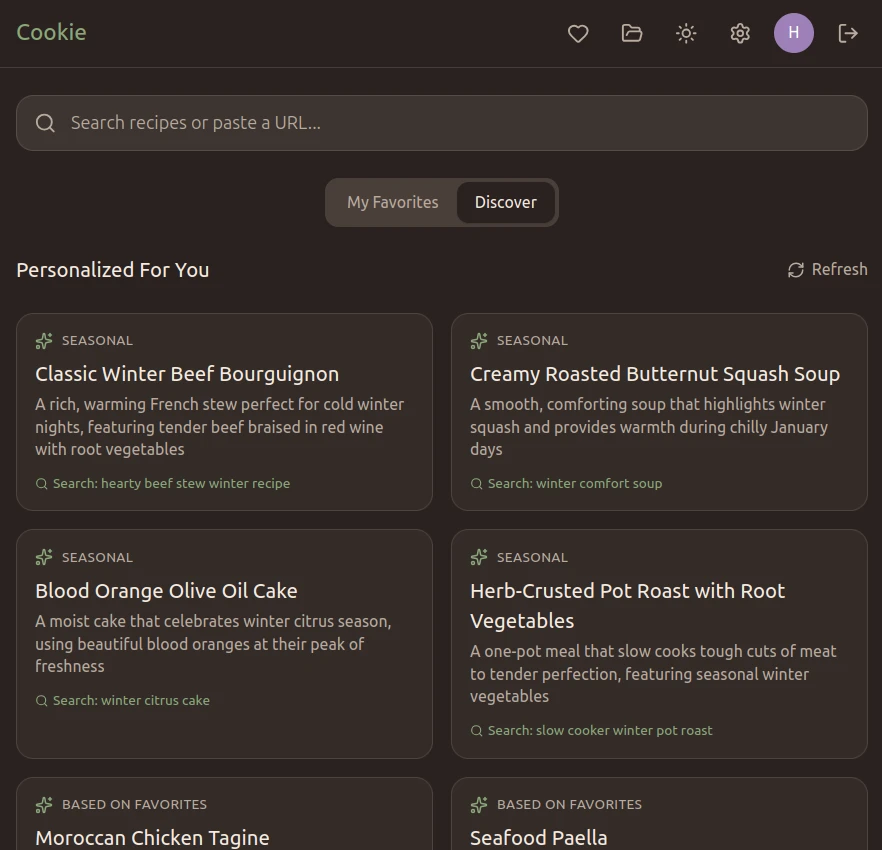
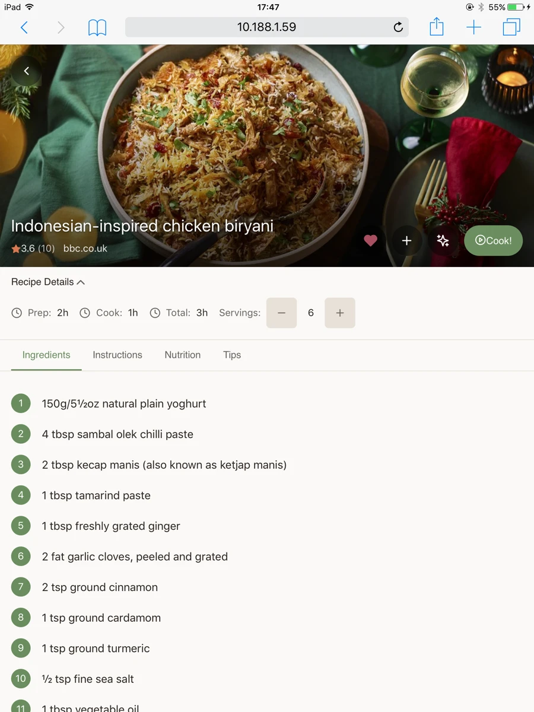
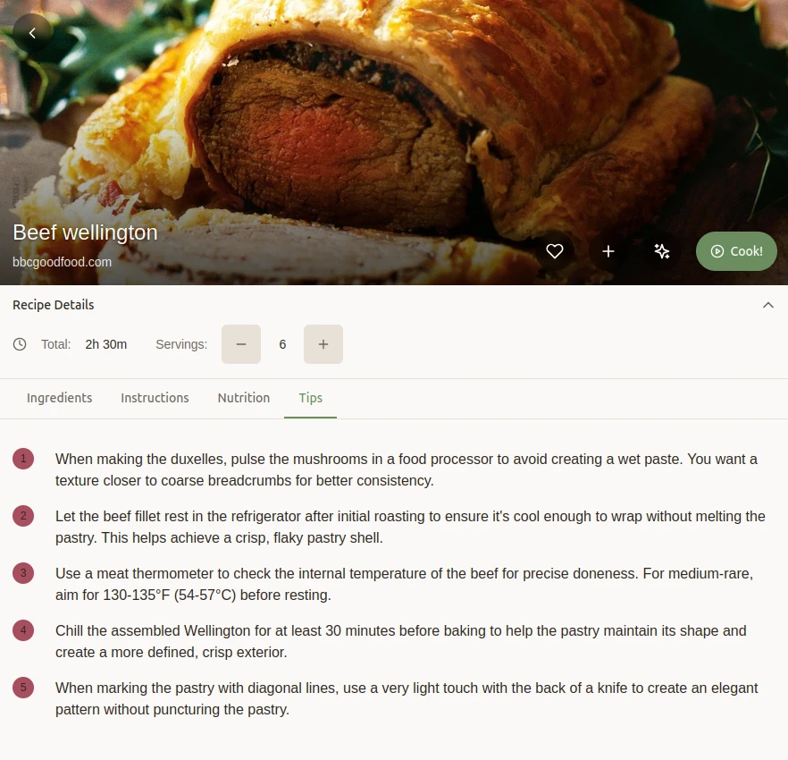
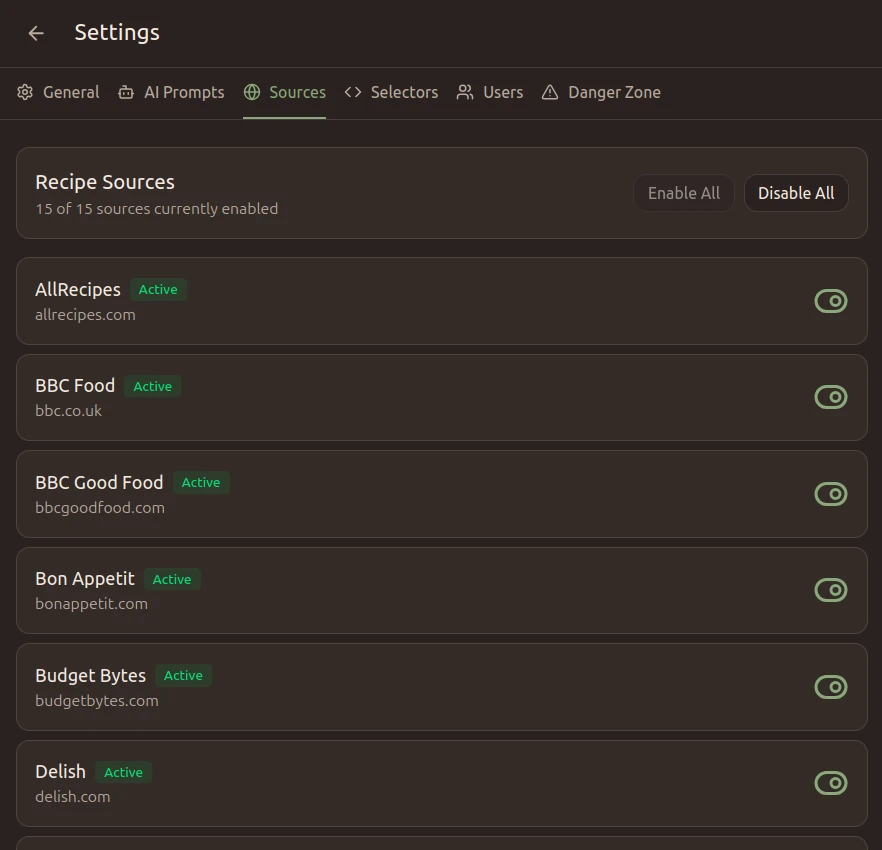

# Cookie

[](https://github.com/matthewdeaves/cookie/actions/workflows/ci.yml)
[](https://matthewdeaves.github.io/cookie/coverage/frontend/)
[](https://matthewdeaves.github.io/cookie/coverage/backend/htmlcov/)
[](https://matthewdeaves.github.io/cookie/coverage/)
[](https://matthewdeaves.github.io/cookie/coverage/)
[](https://matthewdeaves.github.io/cookie/coverage/)

[**View Metrics Dashboard**](https://matthewdeaves.github.io/cookie/coverage/) - Test coverage, complexity analysis, security audits, and bundle size reports

A self-hosted recipe manager for searching, importing, organising, and cooking through recipes from popular cooking websites.

## Running it at home

Cookie is built to run privately on a home network (`AUTH_MODE=home`: no login, everyone on the LAN gets full
access, so keep it off the public internet). The reference setup is one Docker host with a TLS-terminating
reverse proxy in front; the app, its database and the proxy all run in containers.

```bash
# .env: POSTGRES_PASSWORD, ANTHROPIC_API_KEY (optional), ALLOWED_HOSTS, CSRF_TRUSTED_ORIGINS
curl -O https://raw.githubusercontent.com/matthewdeaves/cookie/master/docker-compose.prod.yml
docker compose -f docker-compose.prod.yml --env-file .env up -d
```

Open http://localhost and start importing recipes. Data persists in Docker volumes (`cookie-postgres-data`,
`cookie-media`). On the author's home server the stack runs from that server's own compose file (host networking,
`NGINX_LISTEN` moves the in-container nginx off port 80, a TLS reverse proxy serves `https://cookie.<home domain>`).
See the [Deployment Guide](docs/DEPLOYMENT.md).

## Quick Start (Development)

Clone and run the development stack:

```bash
git clone https://github.com/matthewdeaves/cookie.git
cd cookie
bin/dev setup   # Install pre-commit hooks (requires: pip install pre-commit)
bin/dev up
```

Open http://localhost:3000 - hot reload enabled for both frontend and backend.

## Screenshots

<table>
  <tr>
    <td align="center"><br><strong>Home</strong></td>
    <td align="center"><br><strong>Search</strong></td>
    <td align="center"><br><strong>Recipe</strong></td>
  </tr>
  <tr>
    <td align="center"><br><strong>Cook Mode</strong></td>
    <td align="center"><br><strong>AI Tips</strong></td>
    <td align="center"><br><strong>Discover</strong></td>
  </tr>
  <tr>
    <td align="center"><br><strong>iPad</strong></td>
    <td align="center"><br><strong>Legacy iPad</strong></td>
    <td align="center"><br><strong>Settings</strong></td>
  </tr>
</table>

<p align="center">
  <a href="docs/SCREENSHOTS.md"><strong>View full screenshot gallery</strong></a> including all features and legacy iPad support
</p>

## Features

**Import**
- Search 15 popular recipe sites simultaneously (AllRecipes, BBC Good Food, Serious Eats, Simply Recipes, Epicurious, Bon Appetit, Tasty, The Kitchn, Budget Bytes, Delish, Skinnytaste, Southern Living, The Pioneer Woman, Taste of Home, BBC Food)
- Import any recipe by URL
- Automatic extraction of ingredients, steps, and timings

**Organise**
- Multi-profile system (family members, dietary preferences)
- Collections and favorites
- Recipe notes and modifications

**Cook**
- Step-by-step cooking mode
- Built-in timers with audio alerts
- Wake-lock to keep screen on

**AI-Powered (optional)**
- Recipe remix suggestions
- Serving size adjustments with recalculated ingredients
- Cooking tips and substitutions
- Personalized discovery suggestions
- Runs on Claude Haiku 5.5 by default; all AI features are hidden when no API key is configured

## Architecture

```
                    ┌───────────────────────────────────────────────────┐
                    │           Production Container                    │
   Port 80 (or      │                                                   │
   NGINX_LISTEN)    │                                                   │
  ─────────────────►│ nginx                                             │
                    │  ├─ /api/, /admin/, /legacy/ ► gunicorn ─► Django │
                    │  ├─ /static/ ──► /app/staticfiles/                │
                    │  ├─ /media/ ──► /app/data/media/                  │
                    │  └─ / ──► React SPA (/app/frontend/dist/)         │
                    │                                                   │
                    │  Browser Detection:                               │
                    │  └─ iOS <11, IE, Edge Legacy ──► /legacy/         │
                    └───────────────────────────────────────────────────┘
                                         │
                                         ▼
                              ┌──────────────────┐
                              │   PostgreSQL     │
                              └──────────────────┘
                                         │
                                         ▼ (optional)
                              ┌──────────────────┐
                              │  Anthropic API   │
                              └──────────────────┘
```

- Production: nginx + gunicorn (web container) + PostgreSQL (db container)
- Automatic legacy browser detection and redirect

## Tech Stack

| Layer | Technology |
|-------|------------|
| Web Server | nginx (routing, static files, browser detection) |
| Backend | Django 5, django-ninja, gunicorn |
| Frontend | React 19, TypeScript, Vite, Tailwind |
| Legacy | ES5 JavaScript (iOS 9 compatibility) |
| Database | PostgreSQL |
| AI | Anthropic API (Claude Haiku 5.5 default) |
| Deployment | Docker Compose (amd64, arm64) |

## Compatibility

- Modern frontend: any modern browser
- Legacy frontend: tested on iPad 3 (iOS 9.3.6 Safari)
- Responsive design for mobile, tablet, and desktop

## Configuration

### Environment Variables

| Variable | Required | Description |
|----------|----------|-------------|
| `DATABASE_URL` | Yes | PostgreSQL connection string |
| `AUTH_MODE` | No | `home` (default, no login) or `passkey` (WebAuthn authentication) |
| `DEBUG` | No | Set to `false` in production (default) |
| `ALLOWED_HOSTS` | No | Comma-separated hostnames (default: `*`) |
| `CSRF_TRUSTED_ORIGINS` | No | Full URLs for CSRF protection |
| `SECRET_KEY` | No | Auto-generated if not set |
| `ANTHROPIC_API_KEY` | No | Anthropic API key (can also be set via Settings UI; the env var wins) |
| `NGINX_LISTEN` | No | `[addr:]port` for the in-container nginx instead of 80 (host-network setups) |

See [CLAUDE.md](CLAUDE.md) for the full list of environment variables including passkey and logging configuration.

### Data Persistence

Data is stored in two Docker volumes:
- `cookie-postgres-data` - PostgreSQL database
- `cookie-media` - Uploaded images

## Data Privacy

- Fully self-hosted — all data stays on your server
- No email addresses or passwords — passkey mode uses WebAuthn, home mode needs no login
- No analytics, tracking, or third-party scripts
- No advertising identifiers or device fingerprints
- Only functional cookies (session + CSRF) — no cookie consent banner needed under UK PECR
- AI requests go to the Anthropic API only if an API key is configured; recipe text only, no personal data
- Privacy policy available at `/privacy/` with links to source code as proof
- See the [project constitution](.specify/memory/constitution.md) for privacy-by-architecture principles

## Basic Usage

1. **Import recipes**: Search across 15 recipe sites and import with one tap
2. **Organise**: Create profiles for family members, add recipes to collections
3. **Cook**: Open a recipe and enter cooking mode for step-by-step guidance
4. **AI features**: Add an Anthropic API key in Settings (or set `ANTHROPIC_API_KEY`) to enable remix suggestions, cooking tips, and personalized discovery

## Development

### Prerequisites

- Docker and Docker Compose

### Getting Started

```bash
git clone https://github.com/matthewdeaves/cookie.git
cd cookie
bin/dev up        # Start development stack on port 3000
```

### Development Commands (`bin/dev`)

```bash
bin/dev up              # Start development stack (port 3000)
bin/dev down            # Stop development stack
bin/dev logs -f         # Follow logs
bin/dev test            # Run pytest
bin/dev shell           # Django shell
bin/dev migrate         # Run migrations
bin/dev npm test        # Run frontend tests
```

### Production Commands (`bin/prod`)

```bash
bin/prod up             # Start production container (port 80)
bin/prod down           # Stop production container
bin/prod pull           # Pull latest image from GHCR
bin/prod update         # Pull and restart
bin/prod logs -f        # Follow logs
bin/prod health         # Check container health
bin/prod build          # Build production image locally
```

### Port Configuration

| Environment | Port | URL |
|-------------|------|-----|
| Development | 3000 | http://localhost:3000 |
| Production  | 80   | http://localhost |

## Code Quality

22-job CI pipeline (path filters skip docs/markdown):

**Frontend (7 jobs):** lint (ESLint), typecheck (TypeScript), test (Vitest), complexity, duplication, security (npm audit), bundle analysis

**Backend (5 jobs):** lint (ruff), test (pytest), complexity (radon), duplication (jscpd), security (pip-audit + Bandit SAST)

**Legacy (2 jobs):** lint (ESLint ES5), duplication (jscpd)

**Security & Infrastructure (7 jobs):** secrets detection, Trivy container scan, Semgrep SAST, Hadolint Dockerfile lint, Gitleaks, Django deploy check, migration check

**Final (1 job):** ci-success aggregator

- [Quality Dashboard](https://matthewdeaves.github.io/cookie/coverage/) - comprehensive metrics with live data and detailed reports
- [Metrics JSON API](https://matthewdeaves.github.io/cookie/coverage/api/metrics.json) - programmatic access to all metrics
- Automated dependency updates via Dependabot (weekly for pip, npm, GitHub Actions)
- Auto-generated GitHub releases with categorized changelog on version tags

## Documentation

- [Deployment Guide](docs/DEPLOYMENT.md) - Running at home: compose, reverse proxy, updates, backups
- [Architecture](docs/ARCHITECTURE.md) - System design, data models, API structure
- [AI Features](docs/AI-FEATURES.md) - AI capabilities, configuration, customization
- [Screenshots](docs/SCREENSHOTS.md) - Full visual tour of modern and legacy frontends
